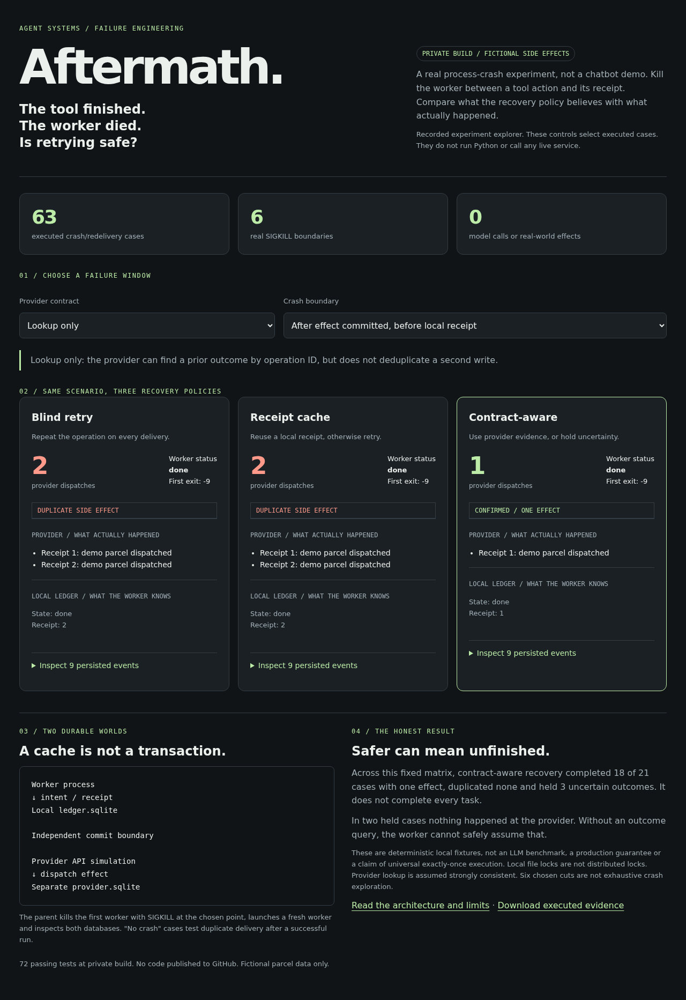
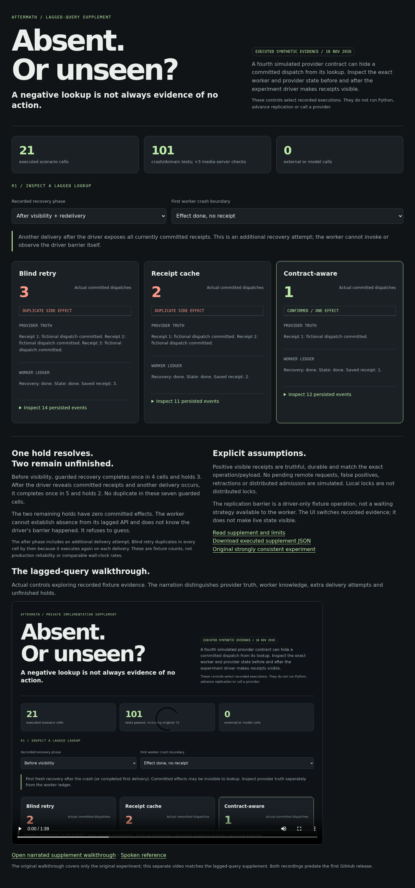

# Aftermath

[Original browser walkthrough](docs/walkthrough.mp4) · [Lagged-query supplement](SUPPLEMENT.md) · [Supplement narrated walkthrough](docs/eventual-walkthrough.mp4)




**The tool finished. The worker died. Is retrying safe?**

A crash-recovery lab for the execution layer of tool-using agents. It kills
real Python worker processes at six boundaries around a fictional side
effect, starts new processes, then compares three recovery policies against
the provider's persisted state. No model key, framework or paid service.

The interesting failure is the gap between **an external action committing**
and **a local receipt being saved**. A local cache does not close that gap.
Neither does asking a language model whether it thinks the action happened.

## Two separate experiments

The original 13 November lab tests three provider contracts in 63 cases. The 20 November supplement adds a lagged-lookup contract in 21 separate cells. Both include actual subprocess crashes, recorded evidence, screenshots and a matching walkthrough. The current combined suite passes 104 tests: 101 crash/domain checks and 3 local media-server checks. The supplement video records the 101 domain checks before the server checks were added.



## Try it

Python 3.10+, Linux/macOS (uses `fcntl` locks and SIGKILL).
Runtime: standard library only. Tests: pytest.

```sh
python3 -m aftermath.lab --out evidence/matrix.json
python3 -m aftermath.serve --port 8080
# original: http://127.0.0.1:8080/web/
# supplement: http://127.0.0.1:8080/web/eventual.html

python3 -m pip install -r requirements-dev.txt
python3 -m pytest tests -q
```

The viewer loads the executed matrix, not a live model. Controls explore
recorded runs; they do not execute Python or create real side effects.
To generate fresh evidence, rerun the CLI and refresh the viewer.

## What is actually built

- **A separate provider database.** The worker's intent/receipt ledger and
  the fake provider's side effects are independent SQLite databases. There
  is no cross-database transaction pretending to solve a remote problem.
- **Actual abrupt death.** The first worker SIGKILLs itself before intent,
  after intent, before the effect, inside the provider transaction, after
  the effect commits, or after the local receipt commits. A new subprocess
  starts against the same files. This is not an exception-retry simulation.
- **Three explicit provider contracts.** `keyed` atomically deduplicates a
  stable operation ID and rejects payload changes; `searchable` offers a
  strongly consistent outcome query but no deduplication; `opaque` offers
  neither. These are simulated contracts, not real vendor integrations.
- **Three policies over identical fixtures.** `blind` always retries;
  `receipt` consults its local cache; `guarded` writes intent first, uses
  provider keys/reconciliation when available, and holds unknown outcomes.
- **Process-safe admission.** An OS file lock serializes local workers and
  is released on death. A separate test races eight worker processes.
- **A visual evidence explorer.** Inspect the two durable worlds side by
  side, compare policies and read their event trails.

## Executed results

Run on 2026-11-13, Python 3.10, Unix environment. The matrix contains
**63 cases**: 3 policies x 3 provider contracts x (6 crash cuts + one
successful execution followed by duplicate delivery).

| Policy | Cases | Completed with one effect | Duplicate effects | Held for review |
|---|---:|---:|---:|---:|
| Blind retry | 21 | 15 | 6 | 0 |
| Receipt cache | 21 | 19 | 2 | 0 |
| Contract-aware | 21 | 18 | 0 | 3 |

**72 tests pass**, including all 63 subprocess cases, eight-worker
concurrency, payload conflicts, sticky holds and transaction rollback.
Raw evidence: `evidence/matrix.json`. Exact command output:
`evidence/pytest.txt`. See `evidence/environment.json` for runtime and
source SHA-256 hashes. Regenerate both when changing the source.

The guarded policy does **not** complete every task. With an opaque
provider it holds three uncertain outcomes, including two with no actual
effect. That is the availability cost of refusing a duplicate or a false
success claim when the worker cannot verify the result.

## Read one failure

Select **Lookup only / After effect committed** in the viewer.

1. First worker durably records intent.
2. Provider commits dispatch of one fictional parcel.
3. First worker dies before its local receipt is durable.
4. Receipt-cache policy sees no receipt, retries, and creates a second
   dispatch. The process returns success, but the external state is wrong.
5. Contract-aware policy queries the provider by stable operation ID,
   finds the original receipt, and saves it without repeating the dispatch.

Change the provider to **No evidence API**: the contract-aware policy
holds instead. This is not a universal exactly-once guarantee.

## Architecture

```text
already-authorized operation proposal
                |
         worker process ---- OS file lock (local workers only)
                |
       intent / receipt ledger.db
                |
       simulated provider API
                |
         independent provider.db

parent lab process -> crash first worker -> launch recovery worker
                   -> inspect both databases -> exported evidence -> viewer
```

The proposal is fixed, not generated by an LLM. This project isolates tool
execution reliability; it does not claim autonomous planning intelligence.
It could sit below a model-driven planner, but no model adapter is included
or tested. No real payments, messages, bookings or account changes occur.

## Limits that matter

- Six selected program points, not exhaustive machine-instruction crash
  exploration. SIGKILL is process death, not host power loss or disk failure.
- SQLite durability depends on the OS/filesystem. The tests do not prove
  hardware failure tolerance.
- Reconciliation assumes a strongly consistent provider lookup and a
  single locally coordinated writer. The separate [lagged-query supplement](SUPPLEMENT.md) models delayed lookup visibility; multi-host
  workers, idempotency expiry and ambiguous provider errors are not modeled.
- The file lock is host-local. This is not a distributed workflow engine.
- The provider key implementation is part of the fixture. Its guarantees
  must not be attributed to arbitrary third-party tools.
- Events are diagnostic. Recovery deliberately uses the operation ledger
  and provider contract, not unstructured logs. Some cuts occur after a
  provider-return diagnostic event but before the authoritative receipt.
- A held task requires a separate decision workflow. The project does not
  offer a button that silently retries an unknowable operation.
- Repeated deterministic fixtures are not independent benchmark samples.
  No confidence intervals, unseen-task scores or model comparisons claimed.
- Both databases contain fictional data only. Never use this lab as a
  production tool executor or point it at live business accounts.

## Related work and design sources

Fault injection and durable agent runtimes already exist. This is a small
independently written teaching implementation, not a claim to have invented
them. No source code from these projects is included.

- AgentFault: stateful interventions around tool-using agents.
  https://pypi.org/project/agentfault/
- AgentFault Lab: controlled fault injection and invariant checking.
  https://github.com/faraz-369/agentfault-lab-Web
- Temporal LangGraph integration: durable orchestration and activity
  boundaries. https://docs.temporal.io/develop/python/integrations/langgraph
- LangGraph durable-execution documentation: idempotent operations and
  replay boundaries.
  https://raw.githubusercontent.com/langchain-ai/langgraph/c4144bb48f97e6afeaa002de318580cc41c19893/docs/docs/concepts/durable_execution.md
- State ownership analysis: a receipt does not make an external effect
  atomic with local state.
  https://dzone.com/articles/temporal-langgraph-state-ownership
- Stripe idempotent requests: an example of a provider-side idempotency
  contract and its limits. No Stripe integration is included.
  https://docs.stripe.com/api/idempotent_requests

Compared with the existing portfolio, this is not another agent loop or
lexical answer evaluator. It tests process termination, durable state and
side-effect recovery under explicit provider contracts.
