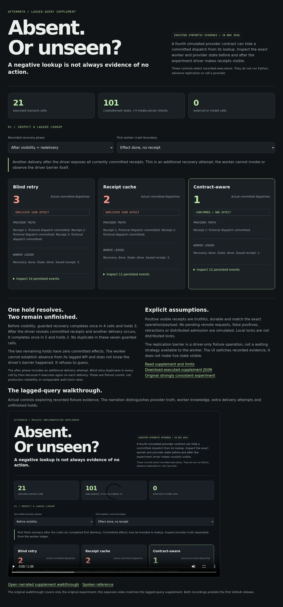

# Aftermath supplement: lagged outcome queries

Implemented 18 November; consolidated and checked 20 November 2026. This is separate from the original 13 November three-contract experiment.

## Why this increment

The original lab explicitly assumes a strongly consistent provider lookup. That assumption is useful but narrow: if a query can lag a committed action, a negative answer does not establish that retrying is safe. This supplement implements that failure mode instead of merely adding a warning.

## Actual implementation

A fourth simulated contract, `eventual`, stores effects in the same independent provider database as before. Its lookup sees only receipts exposed through a separate visibility table. The experiment driver controls an explicit replication barrier. This is not a sleep or a guessed propagation timeout, and the recovery worker cannot call the barrier.

After an ambiguous prior dispatch, guarded recovery accepts a positive matching visible receipt, holds an absent result, and refuses duplicates or conflicting payload evidence. It does not claim an eventual lookup is authoritative negative evidence. Repeating the query does not allow it to dispatch again. Even after the driver has revealed every committed row, the worker still cannot know an empty answer proves no effect, so two zero-effect cases remain held.

The current positive-evidence assumption is also explicit: visible matching receipts are durable, truthful and exact. This experiment does not simulate false positive results, receipt retraction, pending remote requests or distributed admission. The local file lock remains a local process coordination mechanism.

## Commands

Use Python 3.10+ on Linux/macOS. Runtime is standard library only; tests require pytest.

```
python -m pytest tests -q
python -m aftermath.eventual_lab --out evidence/eventual-matrix.json
python -m aftermath.serve --port 8080
# open http://127.0.0.1:8080/web/eventual.html
```

The original `python -m aftermath.lab` still generates its original three-contract 63-case matrix. The supplement does not overwrite the old historical matrix or its web viewer.

## Executed evidence

101 crash/domain tests passed: the original 72 plus 29 lagged-query checks. A further 3 local media-server tests bring the consolidated suite to 104. The supplement matrix executes 21 cells (3 policies × 7 crash/no-crash boundaries). Every crash cell kills an actual subprocess with SIGKILL, then starts fresh recovery against the same two durable databases. A second recovery runs after the explicit visibility barrier.

| Policy | Before visibility: once / duplicate / held | After visibility: once / duplicate / held |
|---|---|---|
| Blind | 4 / 3 / 0 | 0 / 7 / 0 |
| Receipt cache | 6 / 1 / 0 | 6 / 1 / 0 |
| Contract-aware | 4 / 0 / 3 | 5 / 0 / 2 |

The post-barrier phase is an additional delivery attempt, not the same number of attempts as the pre-barrier phase. Blind retry duplicates in every cell by then because it performs again on each delivery. These are synthetic fixture counts, not a production success rate or a model benchmark.

One guarded hold resolves when a committed effect becomes visible. Two guarded holds remain with no actual effect. Refusing to guess preserves the no-duplicate property in these cells but does not guarantee completion.

Additional checks cover repeatedly hidden committed effects, eventual positive reconciliation, absence remaining inconclusive after a barrier, multiple matches, payload mismatch, idempotent barrier and no automatic visibility of later effects.

## Explore the evidence

Serve the project root with `python3 -m aftermath.serve --port 8080`, then open `http://127.0.0.1:8080/web/eventual.html`. The phase and crash-cut controls select recorded evidence, not live actions. Expand the events to inspect the two durable worlds. Raw results are in `evidence/eventual-matrix.json`.



[Watch the matching 99.6-second narrated walkthrough](docs/eventual-walkthrough.mp4). The recording shows 101 crash/domain checks. Three local media-server checks were added afterward, bringing the current suite to 104 without changing the domain matrix. The local read-only server supports byte-range video seeking and binds to loopback by default. It has no upload or execution endpoint.

The original viewer, original narrated walkthrough and historical 63-case evidence remain separate and unchanged. No real provider or model calls are made. This is not a universal exactly-once guarantee or a production executor.

## Recording and evidence dates

The recordings and screenshots were made for private review before the first GitHub release. Their on-screen private-build labels describe that recording date, not current repository access. Historical environment manifests describe those dated runs, not current source hashes. `evidence/release-environment.json` records this release tree.
